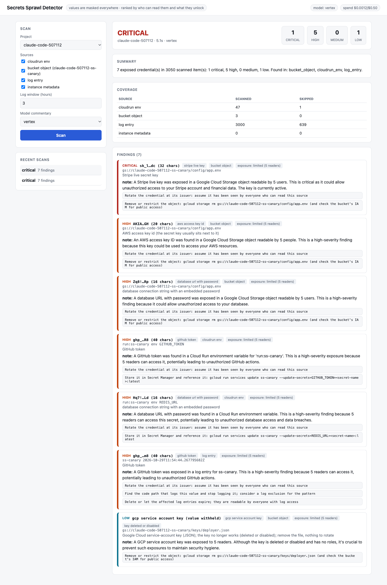

# gcp-secrets-sprawl-detector

Credentials leak into more places than source control: Cloud Run environment variables, bucket objects (Terraform state, `.env` files), application logs, VM metadata.
This tool scans those places in a GCP project (read-only), finds credentials, and **ranks them by who can read the place they were found and what the credential can do**,
with a fix for each. Secret values never leave the scanner: every finding carries a masked preview only, and models see redacted metadata.



## What it does

| Source | How | Exposure is "who holds a role that can read it" |
|---|---|---|
| Cloud Run env vars | Admin API v2; Secret Manager references are skipped (the right pattern) | run viewer/developer/admin, project viewer/editor/owner |
| Bucket objects | allow-listed buckets, text-like files up to 512 KB; public if the bucket grants allUsers | bucket + project storage roles |
| Cloud Logging | recent entries (text and JSON payloads) | logging viewer roles |
| VM / project metadata | Compute API | compute viewer roles |
| Local directory (`sprawl scan-dir`) | files, skipping `.git`, virtualenvs, caches | unknown |

Detects AWS, Google (API keys, OAuth/refresh tokens, **service-account key JSON**, private keys), GitHub/GitLab/Slack/Stripe/OpenAI/Anthropic/SendGrid/npm tokens, JWTs,
database URLs with passwords, URLs with credentials, and generic high-entropy secret assignments, skipping placeholders and code that merely handles secrets.
For a leaked service-account key it asks IAM (with the scanner's own identity, never the leaked key) whether the key is still active and what roles the account holds:
an active key on an Editor/Owner account is critical; a key that no longer exists is low.

## Quick start

```bash
python3 -m venv .venv && .venv/bin/pip install -e ".[dev]"
.venv/bin/sprawl scan-dir ./my-repo; echo "exit=$?"                  # 0 clean, 1 attention, 2 critical
.venv/bin/sprawl scan my-project --sources cloudrun_env,log_entry --hours 24
.venv/bin/sprawl scan my-project --bucket my-bucket --llm vertex      # bucket scanning is opt-in, per bucket
```

## Deploy to GCP

```bash
cp deploy.env.example deploy.env && ./scripts/up.sh
gcloud run services proxy secrets-sprawl --region us-central1 --port 8081
./scripts/down.sh
```

Terraform creates APIs, Artifact Registry, a build identity, the runtime service account (read-only `run.viewer`, `logging.viewer`, `compute.viewer`, `iam.securityReviewer`,
`aiplatform.user`, plus `objectViewer` on the canary bucket only), a private Cloud Run service (one invoker, no `allUsers`) with project and bucket allow-lists, and the canary resources
used for validation. Scanning other projects or buckets returns 403.

Docs: [architecture](docs/architecture.md) · [threat model](docs/threat-model.md) · [runbooks](docs/runbooks/) · [ADRs](docs/adr/) · [**validation**](docs/validation-results.md) · [model eval](docs/eval-results.md)

## Verification

| Check | Result |
|---|---|
| Offline tests | 52 pass: every detector, benign and code-that-handles-secrets cases, masking, exposure, severity, key-status lookup (active / dead / unknown / disabled), no-leak properties across API, CLI and model payloads, note validation, API scope limits |
| **Planted canaries in real GCP** (bucket, Cloud Run env, logs, key file) | **7 of 7 found**; 0 unexpected findings in 47 env vars and 3,000 log entries; benign controls not flagged; local and deployed results identical |
| False-positive sweep over 1,335 real files in 16 repos | first version: 18 false positives from the generic rule; after fixing it: **0**, plus 1 real private key correctly found in a gitignored `.secrets/` directory |
| Model eval (mock, gemini-2.5-flash, gpt-5-nano) | findings identical to the model-free run; **no secret value, preview or fingerprint was ever sent to a model** (audited); no unclean note kept |
| Deployed | unauthenticated = 403; `openai` = 403; other project = 403; other bucket = 403; response bodies contain no planted value |

## Limits

- Pattern-based: it finds credentials with recognisable formats and high-entropy values next to secret-looking names. Low-entropy passwords made only of letters, secrets split across lines,
  and encoded or encrypted blobs are missed. The generic rule skips identifiers and attribute paths on purpose.
- Other credential types (GitHub, Stripe, AWS, database passwords) are **not validated as live**: only service-account keys get a status. Severity relies on type and exposure.
- The "key is active" path was verified by unit tests with a fake IAM only: this project's org policy blocks creating real keys, so the live canary was a fake key file for a real throwaway account.
- Exposure counts principals holding a role that can read the source (project and bucket IAM, curated role sets); it does not expand group membership, evaluate IAM conditions or deny policies.
- Coverage is bounded: 200 objects per bucket, 512 KB per object, 3,000 log entries per scan, only allow-listed buckets. Terraform state in other buckets, Secret Manager contents, container image layers
  and Cloud Build logs are not scanned.
- The deployed runtime identity has broad read roles on logs, Cloud Run config and VM metadata (inherent to the job); keep the invoker role tight.
